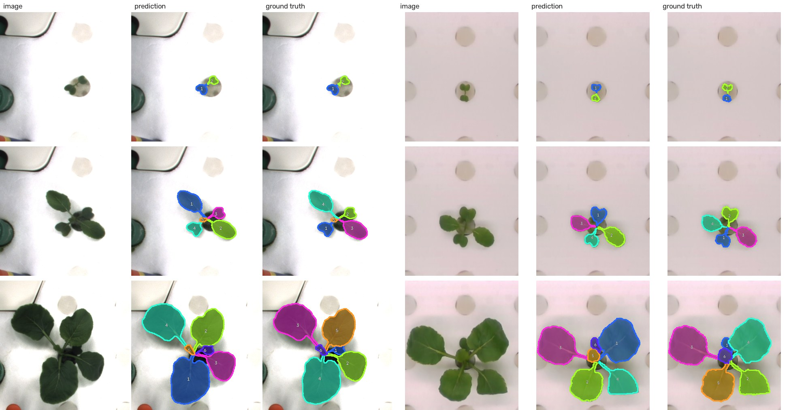

# LeafTrack

**Leaf instance segmentation, tracking, and growth analytics for top-down plant time-lapse imagery.**

> Work in progress: segmentation is trained and evaluated. Leaf tracking, growth analytics and the live Hugging Face demo come next.



*YOLO11n-seg on test plants it never saw in training, early to late growth. Left: multi-view rig; right: RGB-D rig. Leaf numbers are per-image IDs; matching them over time is the tracking stage.*

## What it does

1. **Segment** every leaf in a top-down plant image with a YOLO11-seg model.
2. **Track** each leaf across a time-lapse sequence so it keeps a stable ID.
3. **Analyze** growth: leaf count, per-leaf area, and growth rate over time.

## Project structure

```
leaftrack/        Core package: segment, metrics, evaluation, training, hub, track, analytics
data/scripts/     Dataset download, conversion (to YOLO-seg), splitting, visual checks
configs/          Training configs and the committed plant-level split
train.py          Training entry point (used by Colab/Kaggle notebooks)
evaluate.py       Test-set evaluation and results table
api/              FastAPI service
app.py            Gradio demo (Hugging Face Spaces)
notebooks/        Thin GPU launcher notebooks
tests/            pytest suite
```

## Dataset

[KOMATSUNA](http://limu.ait.kyushu-u.ac.jp/~agri/komatsuna/) (Uchiyama et al., 2017): 1,200 labelled top-down frames of 10 plants over 10 days, with leaf identities that stay consistent over time. That makes it a fit for both segmentation and tracking evaluation.

The data is converted to YOLO-seg polygons and split **by plant, not by frame**, so no plant seen in training appears in validation or test. See [data/README.md](data/README.md) for the verified data format, conversion quality and split. Datasets and model weights are never committed.

## Results

Test split: 240 images of 2 held-out plants (one per capture rig).

| Model | Params | Mask mAP50 | Mask mAP50-95 | SBD ↑ | FBD ↑ | \|DiC\| ↓ | Exact leaf count | CPU latency* |
|---|---|---|---|---|---|---|---|---|
| **YOLO11n-seg** (demo model) | 2.8 M | **0.987** | **0.825** | 0.930 | 0.970 | 0.25 | 82% | **240 ms** |
| YOLO11s-seg | 10.1 M | 0.965 | 0.806 | **0.934** | **0.971** | **0.19** | **85%** | 672 ms |

\* Median per image at 640 px on 2 CPU threads, matching the free Hugging Face Spaces tier.

- **The nano model is the right choice for the demo.** It matches the small model within 0.004 SBD and is 2.8× faster on CPU.
- **SBD / FBD / DiC** are the [CVPPP leaf segmentation](https://link.springer.com/article/10.1007/s00138-015-0737-3) metrics. SBD measures how well each leaf is segmented, FBD how well the plant is separated from the background, and |DiC| the error in leaf count.
- **How the leaf metrics are computed:** at a confidence threshold chosen on the **validation** plants, so the test plants stay unseen, scored against the original color labels.

### What made the difference

COCO mAP looked excellent from the start, but leaf counting was off by 1.6 leaves per image. The cause was not the model: multi-view crops contain **leaves of neighbouring plants** at the image edge, which the labels correctly ignore. LeafTrack drops edge leaves that never reach toward the plant centre. On the ground truth this rule removes 0 of 5,820 true leaves.

| YOLO11n, test split | SBD ↑ | \|DiC\| ↓ | Exact leaf count |
|---|---|---|---|
| Ultralytics default (conf 0.25) | 0.738 | 1.60 | 22% |
| + threshold selected on validation (0.30) | 0.749 | 1.45 | 24% |
| + neighbour-leaf filter | **0.930** | **0.25** | **82%** |

Full reports, including per-rig breakdowns, are written by `evaluate.py` (`metrics.json`, `results.md`, `per_image.csv`).

## Training

Training runs on a free T4 via the launcher notebooks ([Colab](notebooks/train_colab.ipynb), [Kaggle](notebooks/train_kaggle.ipynb)) or on any local GPU:

```bash
pip install -e ".[train]"
python data/scripts/download_komatsuna.py     # ~125 MB, resumable
python data/scripts/convert_komatsuna.py
python data/scripts/split_dataset.py
python train.py --config configs/train_yolo11n.yaml --project runs/segment --name yolo11n
python evaluate.py --weights runs/segment/yolo11n/weights/best.pt --device 0
```

- **Recipe:** pretrained YOLO11-seg, 640 px, cosine LR, early stopping, plus full-rotation and vertical-flip augmentation (top-down plants have no canonical orientation).
- **Checkpoints:** written every 10 epochs, and `--resume` continues an interrupted run from `last.pt`.
- **These results** come from a laptop RTX 3050 (6 GB). YOLO11n trained with a 150-epoch budget, early-stopped at epoch 116 (best epoch 73), in 42 minutes. YOLO11s trained for 80 epochs at batch 8 in 53 minutes. The configs now default to 80 epochs with patience 20.

Weights are published to the Hugging Face Hub (`python -m leaftrack.hub`), never committed to git.

## Development

```bash
python -m venv .venv
source .venv/bin/activate   # Windows: .venv\Scripts\activate
pip install -e ".[dev]"
pytest
```

## License

[MIT](LICENSE)
